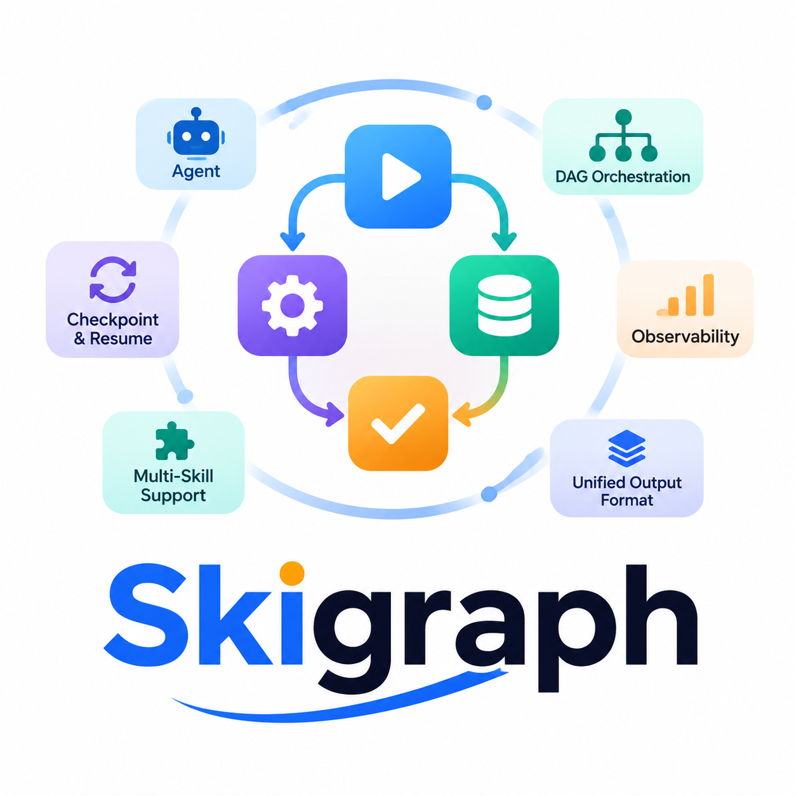

<p align="center"></p>
<h1 align="center">SkillGraph</h1>
<p align="center"><strong>Orquestación con contratos para Agent Skills, flujos científicos y entregables reproducibles.</strong></p>
<p align="center">Idiomas: <a href="README.md">English</a> · <a href="README.zh-CN.md">简体中文</a> · <a href="README.zh-TW.md">繁體中文</a> · <a href="README.ja.md">日本語</a> · <a href="README.ko.md">한국어</a> · <a href="README.es.md">Español</a></p>

## Concepto

SkillGraph es una capa de orquestación entre un AI Agent y sus Agent Skills. Convierte tareas complejas en grafos de trabajo verificables, reanudables y observables.

El Agent realiza el razonamiento, las llamadas a herramientas, el código y el trabajo científico. SkillGraph controla las etapas, los contratos de entrada/salida, las ramas, los bucles, los presupuestos, el estado y la validación de artefactos.

```text
Prompt del usuario → etapa Agent → SKILL.md → contrato de artefactos → siguiente etapa / bucle de calidad
```

## Significado del logo

- **Agent**: razonamiento, herramientas, código y tareas de cada etapa.
- **DAG Orchestration**: nodos y aristas YAML para dependencias y ramas.
- **Checkpoint & Resume**: estado, visitas, eventos y artefactos persistentes.
- **Multi-Skill Support**: una etapa puede cargar varios `SKILL.md` complementarios.
- **Observability**: graph hash, skill hash, checksums y eventos de ejecución.
- **Unified Output Format**: todas las etapas usan `node_result.json`.
- **Marca central**: el flujo solo avanza cuando los entregables obligatorios pasan las validaciones.

## Funciones principales

- Grafos YAML y enrutamiento determinista.
- Etapas con uno o varios Skills.
- Fijación de Skills mediante SHA-256.
- Validación de artefactos, JSON Schema, rutas y tamaños.
- Escrituras atómicas, bloqueos de archivos, manifests y eventos.
- Pausa, reanudación, reintento y bucles limitados.
- Adaptadores CLI y MCP stdio.
- Flujos para algoritmos, medicina, bioinformática y revisiones bibliográficas.

## Flujos de artículos científicos

| Workflow | Uso |
|---|---|
| `paper` | Investigación empírica general |
| `paper-algo` | Innovación algorítmica y ML |
| `paper-medical` | Investigación clínica y síntesis de evidencia |
| `paper-bioinfo` | Ómicas y bioinformática |
| `paper-survey` | Revisión bibliográfica |

El ciclo completo es: pregunta → literatura → método → experimento → estadística → figuras científicas → manuscrito largo → revisión → bucle de revisión → auditoría de citas → LaTeX → PDF → puerta de calidad.

## Inicio rápido

```bash
npm install
npm run build
node dist/cli.js list
node dist/cli.js run paper-algo '{"prompt":"Investigar un algoritmo de streaming reproducible"}'
```

## LaTeX y PDF

```bash
export PATH="$HOME/.local/bin:$PATH"
npm run compile-paper -- path/to/final_paper.tex
```

## Comprobaciones

```bash
npm run qa
npm run audit
npm run smoke
npm test
```

## License

MIT
