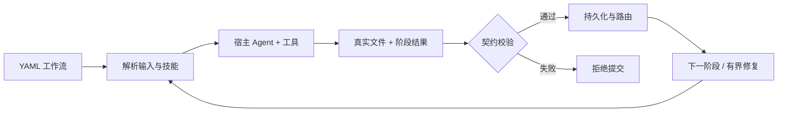

<p align="center">
  
</p>

<h1 align="center">SkillGraph</h1>

<p align="center"><strong>面向 Agent Skill、科研工作流与可复现交付物的契约检查编排引擎。</strong></p>

<p align="center">语言：<a href="README.md">English</a> · <a href="README.zh-CN.md">简体中文</a> · <a href="README.zh-TW.md">繁體中文</a> · <a href="README.ja.md">日本語</a> · <a href="README.ko.md">한국어</a> · <a href="README.es.md">Español</a></p>

<p align="center">
  <a href="LICENSE"></a>
  <a href="package.json"></a>
  <a href="tsconfig.json"></a>
  <a href="skills/README.md"></a>
</p>

<p align="center">
  <a href="#快速开始">快速开始</a> · <a href=".skill-workflows/README.md">工作流文档</a> · <a href="skills/README.md">技能库</a> · <a href="README.md#mcp-adapter">MCP 集成</a> · <a href="https://github.com/Akun-python/Skigraph/issues">反馈问题</a>
</p>

## ✨ 为什么选择 SkillGraph？

**把长对话变成可检查、可恢复的工作流，让每一步都有明确输入、真实文件和有界反馈。**

| 🧩 自由组合 | 🔒 契约校验 | 🔄 状态恢复 |
|:---|:---|:---|
| 用 YAML 声明阶段，一个阶段协同加载多个 Skill。 | 显式输出、路径边界、SHA-256 与可选 JSON Schema 校验。 | 保存 visit、检查点和日志，在预算内暂停、恢复与重试。 |
| **🔬 五类科研流程** | **🔌 接入你的 Agent** | **📦 开箱即有技能** |
| 实证研究、算法、医学、生信与文献综述。 | CLI、MCP stdio 与自定义宿主，不绑定单一模型。 | 31 个已注册 Skill 随仓库提供，不依赖额外 `.vendor` 克隆。 |

> [!IMPORTANT]
> 这是工作流编排引擎，不是科研认证服务，也不是操作系统沙箱。静态检查、产物提交和 PDF 编译成功不代表科学有效、伦理批准或可投稿。模型、数据、Python 依赖与 TeX 工具仍需单独配置；宿主工具拥有其自身权限。

<details>
<summary><strong>📚 文档导航</strong></summary>

- [运行机制](#skillgraph-的运行机制) · [核心能力](#核心能力)
- [科研论文工作流](#科研论文工作流) · [快速开始](#快速开始)
- [LaTeX 与 PDF](#latex-与-pdf) · [质量检查](#质量检查)
- [项目结构](#项目结构) · [安全与稳定性](#安全与稳定性)
- [参与贡献](#参与贡献) · [许可证](#许可证)

</details>

## 项目概念

SkillGraph 位于 AI Agent 与 Agent Skill 之间，负责把复杂任务转换成可验证、可恢复、可观测的工作流图。

Agent 负责推理、调用工具和完成实际科研工作；SkillGraph 负责阶段编排、输入输出契约、分支、循环、预算、状态持久化和产物校验。

```text
用户提示词 → Agent 阶段 → SKILL.md → 交付物契约 → 下一阶段 / 质量循环
```

## SkillGraph 的运行机制



图示说明：工具由宿主 Agent 执行；引擎负责提交校验与图路由，不替代科学审查。

SkillGraph 不会把复杂任务塞进一次非结构化对话，而是把任务转换成一系列显式状态转移。每个状态转移包含四步：

1. **阶段定义**：YAML 节点声明 task、active skill bundle、inputs、required outputs、访问上限和 decision。
2. **上下文解析**：引擎把输入和 artifact 引用解析到前序阶段产生的具体文件；缺少必需输入会停止运行，分支输入可以标记为 optional。
3. **Agent 执行**：宿主 Agent 加载当前阶段的一个或多个 `SKILL.md`，调用工具完成工作，并在 output directory 写入文件。
4. **契约提交**：Agent 提交 `node_result.json`；引擎验证文件、计算 hash、记录状态、选择下一条边，验证通过后才激活下一阶段。

```text
YAML 节点 → 解析输入和 Skill → 加载 SKILL.md → Agent 写文件
→ node_result.json → artifact/path/schema/hash 校验 → 下一阶段或受限循环
```

核心原则是：**Agent 负责生成内容，图负责判断内容是否合格以及下一步做什么。**

### 状态与可追溯性

每次运行保存 workflow version、graph hash、active skill hashes、输入、session 和时间戳。每个阶段有唯一 `visit_id`，每个 artifact 记录生产节点、visit、相对路径、大小、SHA-256 和校验时间。因此下游阶段得到的是确定文件路径，而不是模糊的“最新稿件”。

### 契约而不是提示词约定

- `inputs` 定义阶段允许消费的内容；
- `outputs` 定义必须生成的文件；
- artifact 校验路径边界、文件存在性、大小和 schema；
- `decision` 驱动显式分支；
- `priority` 决定竞争边；
- loop 限制迭代次数并要求输入发生变化；
- release gate 在完成前校验 PDF、图表、引用和可复现性。

### 一个阶段加载多个 Skill

```yaml
- id: methods
  type: agent
  skill: experimental-design
  skills:
    - experimental-design
    - statistical-power
```

runner 会把列表中的所有 `SKILL.md` 注入当前阶段，使实验设计和功效分析、科学写作和图表设计等能力能够协同工作。

### 分支、循环与质量反馈

医学流程可以分成临床队列分析和 meta-analysis；生信流程可以分成 bulk RNA-seq、单细胞和微生物组。各分支产生自己的 artifact，再通过显式输入或 bind 汇合。

工作流声明了 review/revise 修订路径；发布质量门按失败类型返回 figures、citations、format 或 draft。修订稿是否被全部下游正确继承仍需端到端核验，不能仅凭阶段完成状态断言已使用新版本。

## 核心能力

- YAML 工作流图和确定性路由。
- 单 Skill 或多 Skill 阶段。
- SHA-256 Skill 固定，防止运行中 Skill 被静默替换。
- 必需/可选 artifact、JSON Schema、路径和文件大小校验。
- 原子状态写入、文件锁、manifest 和事件日志。
- 暂停、恢复、重试和有上限的质量循环。
- CLI 与 MCP stdio 适配器。
- 缺少信息时的结构化提问协议。
- 科研论文、算法、医学、生信和综述工作流。

<a id="科研论文工作流"></a>

## 🔬 科研论文工作流

| 工作流 | 用途 |
|---|---|
| `paper` | 通用实证研究 |
| `paper-algo` | 算法和机器学习创新 |
| `paper-medical` | 临床研究和证据综合 |
| `paper-bioinfo` | 组学和生物信息学 |
| `paper-survey` | 文献综述和领域调研 |

论文闭环：

```text
研究问题 → 文献 → 方法 → 数据/实验 → 统计 → 科学图表
→ 长篇论文 → 同行评审 → 修订循环 → 引用审计
→ LaTeX → Tectonic PDF → 发布质量门
```

<a id="快速开始"></a>

## 🚀 快速开始

需要 **Node.js 22+** 和 npm。克隆后即可获得工作流及其技能文件；真实科研执行仍需配置模型和领域依赖。

```bash
git clone https://github.com/Akun-python/Skigraph.git
cd Skigraph
npm install
npm run build
node dist/cli.js list
```

启动工作流：

```bash
node dist/cli.js run paper-algo '{"prompt":"研究一个可复现的流式算法"}'
```

真实 Agent 驱动：

```bash
node scripts/agent-run.mjs \
  --plan paper \
  --model glm-5.3 \
  --prompt "Does temperature scaling reduce overconfidence in small neural networks?"
```

## LaTeX 与 PDF

```bash
export PATH="$HOME/.local/bin:$PATH"
npm run compile-paper -- path/to/final_paper.tex
```

编译工具会生成 PDF、读取页数，并在论文过短时失败。科研工作流还会检查图表、引用、方法、结果、限制、可复现性和数据代码说明。

<a id="质量检查"></a>

## ✅ 质量检查

```bash
npm run build
npm run qa
npm run audit
npm run smoke
npm test
```

## 项目结构

```text
.skill-workflows/
  graph/skills.yaml
  workflows/*.yaml
  README.md

scripts/
  agent-run.mjs
  audit-workflows.mjs
  compile-paper.mjs
  smoke-paper.mjs
  validate-workflows.cjs

skills/                    # 31 个已注册技能及配套资源
  <id>/SKILL.md
  README.md                # 上游来源与许可证说明
  LICENSE.K-Dense.md

src/
  core/                    # 引擎、加载器、产物和状态存储
  adapters/                # CLI/MCP 与宿主适配
  tests/                   # 回归与工作流契约测试
```

## 安全与稳定性

- 工作流和 Skill 路径限制在配置根目录内。
- 每次运行记录 graph hash 和全部 Skill hash。
- graph 或 Skill 修改后，旧 run 不会静默恢复。
- 状态写入使用原子文件和文件锁。
- visit、agent turn、loop、时间和工具调用均有预算限制。
- artifact 不能逃逸当前 run 的输出目录。
- API key 不写入 workflow，也不提交到仓库。

<a id="参与贡献"></a>

## 🤝 参与贡献

欢迎提交可复现的 bug、工作流示例、文档改进和小范围 PR：

1. 在 [Issues](https://github.com/Akun-python/Skigraph/issues) 描述问题、预期行为和最小复现步骤。
2. 引擎与路由改动应补充回归测试，提交前运行 `npm run build && npm run qa`。
3. 不提交密钥、未授权数据或未发表稿件；保留第三方许可证。

## 🧭 当前状态与边界

项目仍在演进（`package.json` 版本为 `0.1.0`）。工程测试不能替代科学审查；内容级收敛、修订稿继承和真实模型驱动的端到端执行仍需进一步验证。证据、许可、伦理和作者批准缺失时，必须保持阻塞或等待人工输入。

## 🙏 致谢

内置科学技能来自 [K-Dense scientific-agent-skills](https://github.com/K-Dense-AI/scientific-agent-skills)。详见 [技能来源说明](skills/README.md) 与 [保留的上游许可证](skills/LICENSE.K-Dense.md)；第三方资源内的其他声明仍适用。

<a id="许可证"></a>

## 📄 许可证

版权所有 © 2026 Akun-python。项目采用 [Apache License 2.0](LICENSE)；第三方 Skill 和依赖继续遵循各自的许可证。
